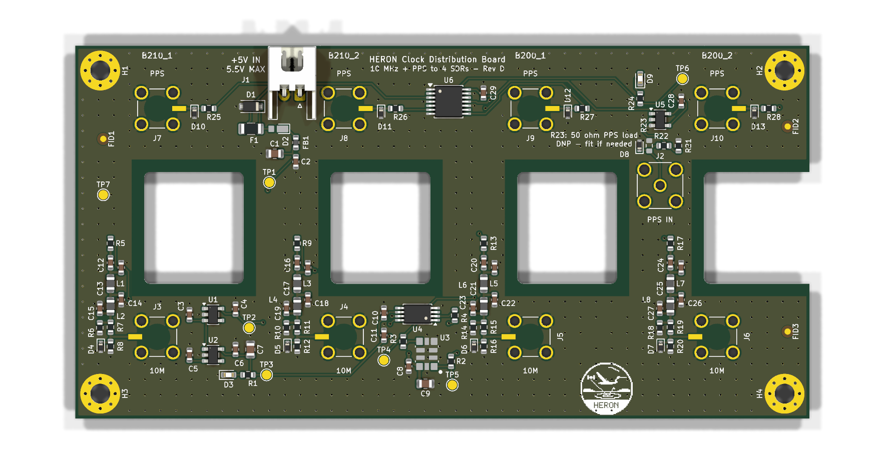

# HERON clock board (rev D): 10 MHz + PPS distribution, jacks on the real SDR connectors

Rev D puts each jack on the SDR connector it must mate with (D-042). The rev C jacks faced the
wrong SMAs (see Q-015 b): the SDR rear edge order is **GPS ANT, 10 MHz, USB-B, PPS, DC jack**
(silkscreen on a B210 and a B200, photos 2026-10-20). The USB-B connector sits between the
10 MHz and PPS SMAs, so the board is taller and has a hole for each USB plug.

**Status: proposed. Not ordered. Not built.**

The circuit, the schematic and the parts are the rev C ones, including the JST XH power
connector J1 (D-040) and the Panjit SOD-323HE land for D2 (D-041).



## What changed from rev C

| Item | Rev C | Rev D |
| --- | --- | --- |
| Board | 118 × 44 mm, rack z 10 to 54 | 118 × 60 mm, rack z 30 to 90 |
| 10 MHz jacks J3–J6 | Faced the SDR GPS ANT SMA (wrong) | Face the SDR 10 MHz SMA (bx 34.16), rack z 43.16 |
| PPS jacks J7–J10 | Faced the SDR 10 MHz SMA (wrong) | Face the SDR PPS SMA (bx 70.89), rack z 79.89 |
| USB-B | Plug above the board | Plug through a 16 × 18 mm hole in the board; the B200_2 hole is an open notch |
| SDR GPS ANT and DC jack | GPS ANT covered by the board | Both stay free for cables: the board stays above the GPS ANT plug and below the DC plug |
| Layout | Rev B layout, patched by `make_revc.py` | New: `gen_pcb.py` places all parts and routes the sensitive nets by hand; Freerouting routes the rest (as rev B) |
| Footprints | KiCad 7 copies (25 `lib_footprint_mismatch` notes) | Loaded from the KiCad 10 library and the project library: no mismatch |
| PPS outputs | Dog-leg around a jack leg (3 starved thermals, D-039) | ESD diode and 22 R straight right of the jack tab: no starved thermals |
| 10 MHz filter columns | Right of the jack | Left of the jack (mirror image of rev C); the jack turns 180° so its tab points at the column |
| DRC | 28 items (accepted) | **0 violations, 0 unconnected, 0 footprint errors, 0 schematic parity issues** |

## Geometry

All numbers come from `revd_geom.py`. Board-local coordinates: mm, (0, 0) = top-left corner seen
from the component side (the side that faces the SDRs). Rack: world X = 46 + x, world Z = 90 − y.

| SDR | PPS jack (y 10.11) | USB hole (x0..x1, y 20.31..38.31) | 10 MHz jack (y 46.84) |
| --- | --- | --- | --- |
| B210_1 | J7 (13.16) | 11.05..27.05 | J3 (13.16) |
| B210_2 | J8 (43.16) | 41.05..57.05 | J4 (43.16) |
| B200_1 | J9 (73.16) | 71.05..87.05 | J5 (73.16) |
| B200_2 | J10 (103.16) | 101.05..118 (notch) | J6 (103.16) |

- **USB holes:** 16 mm (x) × 18 mm (y), 1 mm corner radius, centred 5.89 mm right of the jack axis
  (the USB-B axis is 5.89 mm from the SMA axis, toward the SDR component side). Sized for a generic
  straight USB 3.0 B overmold of 16 × 14 mm with 1 mm clearance (VERIFY with the real cable).
- **Keep-out ring:** 2 mm round each hole, on all four copper layers: no tracks, vias, pads,
  pours or parts. A hole can grow to about 20 × 22 mm by an Edge.Cuts change only.
- **Board edges:** the top edge (rack z 90) is 8.4 mm below the SDR DC jack axis (z 98.4); the
  bottom edge (z 30) is 6.8 mm above the GPS ANT axis (z 23.2). A plug up to about 13 mm in
  diameter fits on each (VERIFY with the real plugs).
- **Mounting holes:** M3, 4 mm from each corner: rack (X, Z) = (50, 86), (160, 86), (50, 34), (160, 34).
- **J1** (JST XH): mouth on the top edge between the B210_1 and B210_2 DC plugs.
- **J2** (PPS IN, SMA): in the gap between the B200_1 and B200_2 blades, so a cable on J2 has open
  space in front of the board, as in rev C.

## Layout

- **10 MHz filter columns:** the rev C column, mirrored, on the line 7.5 mm left of each 10 MHz jack.
  The series parts are 0 R, 100 nF, 820 nH, 820 nH, 17.4 R and the last 294 R (to GND); the shunt
  parts stand beside the line (`SERIES_DY`, `SHUNTS` in `gen_pcb.py`). Each GND pad has its own via.
- **PPS outputs:** jack tab (+x) → node track → TPD1E05U06 pin 1 (GND pin below, with a via) →
  22 R lying flat, pin 2 on the node.
- **Blocks:** power input left of J8 at the top (rev C positions); LDOs under the B210_1 hole (the rev C
  block moved as one piece); TCXO U3 and LMK1C1104 U4 under the B210_2 hole; PPS buffer U6 right of J8;
  PPS input (U5, J2) between the B200 blades.
- **U3 rules (SiT5155 layout guide):** supply via → C8 pin 1 → U3 pin 9 on F.Cu; C8 pin 1 is 1.9 mm
  from pin 9 (rev C: 1.79 mm); C9 pin 1 is 2.8 mm straight under pin 9 (rev C: C9 5.5 mm from U3). A track keep-out on In2 and B.Cu stops other nets
  under U3 (checked: no other-net track under the U3 body).
- **Routing:** hand routes for the filter columns, the PPS chains and the U3 supply and clock. Every
  SMD GND pad gets a stub and a via. Freerouting 1.9.0 routes the other nets (the long 10 MHz feeds
  run mostly on In2, between the In1 GND plane and the B.Cu pour). Then GND pours on all four layers
  and a 2.5 mm stitching-via grid.
- **Stackup:** as rev C. In1 is solid GND. F.Cu, In2 and B.Cu have GND pours.

## Verification status

| Check | Result |
| --- | --- |
| KiCad DRC (KiCad 10.0.6, with schematic parity, 2026-10-20) | 0 violations, 0 unconnected pads, 0 footprint errors, 0 parity issues |
| ERC | 0 errors, 0 warnings |
| Netlist (`check_net.py`) | 110 parts, 51 nets. Single-node nets only on the intentional NC pins U1.4, U2.4, U5.1 |
| Rack fit (`../payload_rack/check_fit.py`, 2026-10-20) | 0 clashes. Mate report: all 8 jacks 0.000 mm radial and axial error (J3–J6 on the SDR 10 MHz SMA, J7–J10 on the PPS SMA). Stop screw access: clear |
| Hardware test | Not done |

## Assembly

1. **U3 SiT5155: use water-soluble flux only. Do not use no-clean flux. Do not use ultrasonic or
   megasonic cleaning.** (SiTime manufacturing guidelines.)
2. Reflow all SMD parts on the top side (`fab/heron_clock_cpl_top.csv`). D2 has the Panjit land: the
   large pad is the cathode.
3. Solder J1 (S2B-XH-A-1) and J2 (132134 SMA) by hand after reflow.
4. **J3–J10 (SMP): solder in place in the rack**, as rev C: jacks loose in their holes, board on the
   rear plate, SDRs and adapters mated, legs soldered from the back through the rear-plate windows,
   then the tabs on top. Do not move an SDR to another slot after this.
5. R23 (49.9 Ω PPS termination) is DNP. Fit it only if the GNSS PPS source needs a 50 Ω load.
6. J1 pin 1 = +5 V, pin 2 = GND. Cable side: XHP-2 housing, SXH-001T-P0.6 terminals.

## How to rebuild

Tools: KiCad 10 (its Python has `pcbnew`), Java 17 or later, Freerouting 1.9.0
(`freerouting-1.9.0.jar` from github.com/freerouting/freerouting; do not put it in git).

```bash
PATH=/Applications/KiCad/KiCad.app/Contents/MacOS:$PATH PYTHON=/Applications/KiCad/KiCad.app/Contents/Frameworks/Python.framework/Versions/Current/bin/python3 KICAD10_FOOTPRINT_DIR=/Applications/KiCad/KiCad.app/Contents/SharedSupport/footprints bash make_fab.sh
```

- `EXPORT_ONLY=1` skips `gen_pcb.py` and only makes the fab outputs from the files as they are.
  Use it after a hand edit of the PCB.
- **Freerouting can give a different route on each run.** A full rebuild changes the copper. Run
  DRC and the rack check again after a rebuild.
- KiCad 10 Python on macOS (2026-10-20): `pcbnew.ZONE_FILLER` crashes, so `kicad-cli` fills the
  zones. Do not make a `pcbnew.BOARD()` and drop it while a loaded board is in use: the next save crashes.

## Files

| Path | Content |
| --- | --- |
| `project/` | KiCad project (schematic = rev C schematic, revision D). `fab/` has the Gerber zip with drill files, BOM, Digi-Key upload, CPL, schematic and assembly PDFs, DRC and ERC reports, top and bottom renders |
| `revd_geom.py` | Board, jack and USB hole geometry, from the rack and SDR data |
| `gen_pcb.py` | Rev D placement table, hand routes, labels and silkscreen art; runs Freerouting |
| `pcbgen.py` | Board-building helpers (footprints from the netlist, tracks, vias, zones, keep-outs, GND vias, stitching, Freerouting round trip) |
| `silk_refs.py` | Reference labels (rev C script; the USB holes are keep-outs) |
| `extract_logo.py`, `logo_polys.json` | The HERON logo outlines, taken from the rev C board (the source SVG is not in every checkout) |
| `design.py`, `gen_sch.py`, `gen_lib.py` | Parts list as Python, schematic generator, project library (rev C, unchanged) |
| `check_net.py`, `make_bom.py`, `bom_sources.csv`, `make_fab.sh` | Netlist check, BOM, purchase data, rebuild and fab outputs |
| `sim/lpf.py` | Filter and output level model (unchanged) |

## Open items

- **USB hole size (VERIFY):** measure the plug overmold of the cable you use. Up to about 20 × 22 mm
  needs only an Edge.Cuts change (keep-out ring).
- **Rear plate:** each SDR column now has a solder window and a 20 × 22 mm USB opening (PROPOSED,
  `REAR_USB_W`, `REAR_USB_H` in `heron_rack.py`). The USB cables leave through the back of the rack.
  Check the plate strength and the cable route to the NUC.
- **GPS ANT and DC plug clearance (VERIFY):** the board edges leave about 6.8 mm (GPS ANT) and 8.4 mm
  (DC) from each plug axis. Check with the real plugs.
- Q-015 (a) `ADAPTER_REACH` and (d) the preload and stop design are still open.
- The PPS source (GNSS receiver model) is still open.
