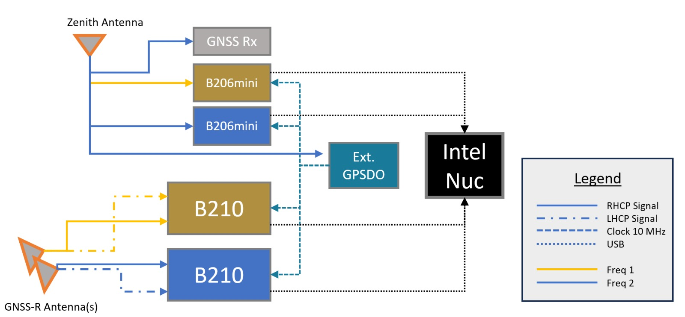

# PAYLOAD_ARCHITECTURE — HERON Sensing Payload

Status: Draft 1, 2026-10-15. Source of the figure: the team's payload
diagram (user, 2026-10-15). Facts come from `HARDWARE.md`,
`DECISIONS.md`, `DATA_FORMATS.md`, `ANTENNAS.md`, and `RF_FRONT_END.md`.
Each unknown is marked **[CONFIRM: ...]**. Do not remove a marker until
the team gives the answer.

This document explains how the sensing payload works: the antennas, the
four SDRs, the six channels, the common clock, and the logging to the NUC.
It ends with the plan for the test surfaces and the truth sources.



## 0. The figure and the current documents disagree

The figure shows older parts. The documents (newer) say something else.
This document follows the documents. The team must decide which is right.

| Item | Figure | Current documents | Action |
| --- | --- | --- | --- |
| Single-channel SDRs | Two **B206mini** | Two **Ettus B200** (D-024, 2026-09-24) | **[CONFIRM: which unit flies?]** Redraw the figure. |
| Clock source | **Ext. GPSDO** | **HERON clock board** with a free-running SiT5155 TCXO (D-025, D-026). It is not GPS-disciplined. | **[CONFIRM: is the GPSDO gone?]** Redraw the figure. |
| PPS | Not shown | PPS goes to all four SDRs (D-024, D-025) | Add a PPS line to the figure. |
| "Freq 1", "Freq 2" | Not named | 1575.42 MHz group and 1176.45 MHz group (D-039) | **[CONFIRM: Freq 1 = L1 group, Freq 2 = L5 group?]** |
| "GNSS Rx" | A grey box on the zenith antenna | The ground station has a ZED-F9P (D-021). The drone-side RTK and PPK receiver is not recorded (Q-016). | **[CONFIRM: what is this receiver, and does it give the PPS?]** |

## 1. Summary

- The payload records **six channels** of raw IQ at the same time.
- **Two channels** record the **direct** signal from a zenith (up-looking)
  RHCP antenna, one for each frequency group.
- **Four channels** record the **reflected** signal from the GNSS-R
  (down-looking) antenna: **RHCP and LHCP** for each frequency group.
- **Four SDRs** make the six channels: two B210 (two channels each) and two
  B200 (one channel each).
- **One clock** feeds all four SDRs: a 10 MHz reference and a PPS, from the
  HERON clock board. This makes the six channels coherent with each other.
- **One computer** (Intel NUC7i3DNB) logs all six channels to a SATA SSD as
  8-bit complex samples. It does no science processing in flight (D-001).

## 2. Signal plan

The seven signals sit on two carriers (D-039):

| Group | Carrier | Signals |
| --- | --- | --- |
| Freq 1 (L1 group) **[CONFIRM: mapping]** | 1575.42 MHz | GPS L1 C/A, GPS L1C, Galileo E1, BeiDou B1C |
| Freq 2 (L5 group) **[CONFIRM: mapping]** | 1176.45 MHz | GPS L5, Galileo E5a, BeiDou B2a |

One recorded channel in a group holds all the signals of that group. The
processing separates them later. The sample rate and bandwidth are
**[CONFIRM: not decided]**. The template uses 22 Msps and about 20 MHz
(`onboard.example.toml`). Check that the bandwidth passes the main lobe of
the 10.23 Mchip/s signals and the BOC side lobes you need.

## 3. Six channels

| # | SDR | SDR channel | Antenna | Polarization | Group | Role |
| --- | --- | --- | --- | --- | --- | --- |
| 1 | B200 no. 1 | RX | Zenith | RHCP | Freq 1 | Direct |
| 2 | B200 no. 2 | RX | Zenith | RHCP | Freq 2 | Direct |
| 3 | B210 no. 1 | Channel A | GNSS-R | RHCP | Freq 1 | Reflected |
| 4 | B210 no. 1 | Channel B | GNSS-R | LHCP | Freq 1 | Reflected |
| 5 | B210 no. 2 | Channel A | GNSS-R | RHCP | Freq 2 | Reflected |
| 6 | B210 no. 2 | Channel B | GNSS-R | LHCP | Freq 2 | Reflected |

(Read from the figure. SDR numbers, channel letters, and the antenna-to-
channel map must live in the config: `antenna_label` for each channel.
Physical labels must match. D-031 shows that crossed labels happen.)

Why this layout:

- Each reflected channel pair (RHCP and LHCP) is on **one B210** at **one
  frequency**. The pair shares one radio chip and one clock. A comparison
  of the two polarizations is then a comparison of two channels with the
  same timing. **[CONFIRM: test the phase coherence between the two
  channels of one B210. It is expected, not measured.]**
- Each direct channel gives the signal that the open-loop tracking of the
  reflected channel needs for timing. The open-loop tracking will use the
  RTK and PPK position to drive the tracking (D-048).
- Two frequency groups on two SDRs make dual-frequency processing (CWF)
  possible: one L1-group signal and one L5-group signal (D-038).

## 4. Antennas

| Role | Antenna | Status |
| --- | --- | --- |
| Zenith (direct) | An up-looking RHCP antenna. It feeds the direct SDR channels and the GNSS receiver. | **[CONFIRM: model.]** On the bench: ANT-03 Abracon APKG5012GD (L1 and L5, RHCP, active, LNA 40 dB) and ANT-04 ArduSimple helical (L1/L2, RHCP, active, no L5). See `ANTENNAS.md`. The helical antenna lists no L5, so it cannot serve the L5 group. |
| GNSS-R (reflected) | One or more down-looking antennas that give RHCP and LHCP. The figure shows "GNSS-R Antenna(s)". | The project will test antennas with different polarizations and properties. The most likely flight antenna is a **dual-polarization, dual-frequency antenna from Prof. Chi-Chih Chen, The Ohio State University** (D-047). **[CONFIRM: frequencies, number of RF ports, how the four outputs map to the two B210 units, mass, size, and permission to name it.]** |

Open points on the RF path:

- The zenith antenna feeds up to four loads (GNSS receiver, two SDRs, and
  the clock source in the figure). **[CONFIRM: splitter, filters, and LNA
  plan.]** `HARDWARE.md` lists them as TBD. Keep the first LNA before any
  splitter so the noise figure stays near the LNA value (see
  `RF_FRONT_END.md`).
- Active antennas need DC power on the RF cable. The plan uses one bias tee
  for each antenna (`RF_FRONT_END.md`). **[CONFIRM: power source, and the
  supply voltage of the Ohio State antenna.]**
- The bench RF budget covers the Abracon patch and the ArduSimple helical
  antenna only. It does not cover the Ohio State antenna.

## 5. The clock (common reference for all four SDRs)

This is the part that makes the six channels one measurement. Decisions:
D-014, D-024, D-025, D-026, D-027, D-028. Design files:
`Hardware/clock_board_revC/`.

### 5.1 What the clock board does

- **10 MHz reference.** A SiTime SiT5155 Super-TCXO
  (SiT5155AI-FK-33E0-10.000000, plus or minus 0.5 ppm) makes 10 MHz. A
  1:4 buffer (LMK1C1104) sends it to four outputs. Each output has a DC
  block, a 5th-order 50 ohm low-pass filter (cut-off about 13 MHz), and a
  3 dB pad. The result is about +7 dBm sine into 50 ohm.
- **Why the filter.** A square 10 MHz wave has harmonics near 1170 and
  1180 MHz and near 1570 and 1580 MHz. These are inside the recorded L5
  and L1 bands. The filter removes them.
- **PPS.** The board takes one PPS (SMA) from a GNSS receiver and buffers
  it to four 3.3 V PPS outputs. **[CONFIRM: which receiver gives the PPS.
  The model is TBD in D-025.]**
- **Power.** 5 V from the payload rail, on a locking JST-GH connector.
- **Fixed frequency.** The TCXO is set at the factory. It has no I2C
  control, and the NUC cannot steer it (D-026).
- **Mechanical.** Rev C: 118 x 44 mm. Eight SMP blind-mate jacks mate
  directly to the rear 10 MHz and PPS SMA ports of the SDRs through one
  adapter each (D-027, D-028). The rack holds the SDR trays. Open values:
  Q-015.

### 5.2 What the clock gives you

| Property | Result |
| --- | --- |
| All SDRs share one 10 MHz | The channels are **coherent with each other**. Frequency error of the TCXO is common to all channels. |
| All SDRs set device time at the same PPS edge | Every recorder starts on the same UTC second. The first-sample time in each file is UTC for PPS-aligned units (`DATA_FORMATS.md`). No offset search after the flight (D-024). |
| The TCXO is free-running | The channels are **not locked to GPS time**. The 10 MHz can be off by up to 0.5 ppm: about 790 Hz at 1575.42 MHz and 590 Hz at 1176.45 MHz. The error is the same for every channel, so differences between channels are not affected. The direct-signal tracking absorbs it. |

What the clock does **not** give you (do not claim it):

- It does not give carrier-phase coherence between the L1-band and L5-band
  local oscillators. Each SDR keeps its own phase offset after each tune.
  **[CONFIRM: measure it before the dual-frequency CWF work depends on it.]**
- It does not give a GPS-disciplined frequency. If the team goes back to a
  GPSDO (as in the figure), update this section. The I2C-tunable TCXO is an
  option that the board does not use today (D-026).

## 6. SDRs and the data path to the NUC

| Item | Value |
| --- | --- |
| Units | 2 x Ettus USRP B210 (2 RX channels each), 2 x Ettus USRP B200 (1 RX channel each). **[CONFIRM: see Section 0.]** |
| Serial numbers | **[CONFIRM: record all four here and in `onboard.toml`.]** |
| Interface | USB 3.0, one cable for each SDR, UHD 4.x |
| Sync inputs | `clock_source = external`, `time_source = external` on every SDR (D-024) |
| Sample format | sc8 (8-bit complex) in the file. sc16 on the USB wire by default (D-009) |
| Computer | Intel NUC7i3DNB: Core i3-7100U, 2 cores and 4 threads, 8 GB RAM. OS on NVMe. IQ data on a SATA SSD (D-013). |

Data rate (sizing rule in `HARDWARE.md`): channels x sample rate x 2 bytes.
For the template: 6 x 22 Msps x 2 bytes = **264 MB/s**. The SATA III
ceiling is about 550 MB/s, so the margin is about 2 times. **[CONFIRM:
use the final rate. Check it with the endurance test in `TESTING.md`.]**
`heron-onboard check-config` prints this sum.

USB points to check: the four SDRs need USB 3.0 ports on at least two
controllers (`lsusb -t`). One shared controller is a suspect for overflows
(see Section 7.3).

## 7. Logging to the NUC

### 7.1 How it works

- **One recorder process for each SDR** (`heron_recorder`, C++ on UHD 4.x,
  D-018). A fault in one SDR does not stop the others. The Python
  supervisor (`heron_onboard`) starts them with all settings on the command
  line.
- **Raw IQ only.** No processing in flight (D-001).
- **Control.** The ground station sends `start`, `stop`, `status`, and
  `ping` (D-019). The payload sends telemetry at 1 Hz. The link is the
  aircraft telemetry link (MAVLink TUNNEL messages, D-016). The payload
  does not read flight mode or arm state (D-012).
- **Fallback.** After boot, the payload waits `control.link_grace_s`
  (default 120 s) for a ground frame. If none comes, it starts recording
  (D-017). It keeps recording if the link drops (D-011).

### 7.2 Files

```
<flight_id>/
  metadata.json                      per-flight record (config copy, timing, totals)
  metadata.yml                       same flight, in the processing team's schema (D-022)
  <sdr_id>/<channel_id>/<utc_start>_<seq>.sc8        raw IQ, I then Q, signed bytes
  <sdr_id>/<channel_id>/<utc_start>_<seq>.sc8.json   sidecar for each segment
  <sdr_id>/<prefix>_recorder_log.txt                 console log of the recorder
```

- One file for each channel and each segment. Default segment: 30 s.
  Segments cut on the sample count, so file edges align with device time.
- A power loss corrupts at most the open segment. `heron-onboard
  rebuild-metadata <flight_dir>` rebuilds the metadata from the sidecars.
- Each sidecar holds the first-sample device time (UTC for PPS-aligned
  units), the sample rate, center frequency, gain, bandwidth, antenna
  label, and the counters `overflows_in_segment` and
  `host_drops_in_segment`.
- `metadata.json` holds the software version (git hash), the SDR serial
  numbers, the clock and time source of each SDR, and the totals.
- Channel names carry the antenna and the role. **[CONFIRM: final naming
  scheme for the six channels and the `antenna_label` values.]**

### 7.3 Status and risks

- **Not yet run on hardware.** The C++ recorder and the MAVLink transport
  have not run on the payload hardware (`CLAUDE.md`, `DATA_FORMATS.md`).
  Do not claim a flight-ready logger.
- **Overflows are a risk for the science.** A sample overflow in a collect
  corrupts the position solve in the processing chain
  (`gnss_processing/local-data/overflow_position_divergence_problem_statement.md`).
  The software counts and logs every overflow and dropped sample (O4).
- **Overflow test is not on the payload.** The 2026-10-12 dual-radio
  overflow test ran on a Linux development machine, not on the NUC
  (D-037). The USB, disk, and CPU findings need a repeat on the NUC.
- **Power.** The NUC and four SDRs on the drone: power draw and mass are TBD
  (`HARDWARE.md`). **[CONFIRM: measure.]**

## 8. Position source (not the SDR data path)

- The drone uses **RTK** in flight to help keep the flight plan and the
  planned specular tracks (D-046).
- **PPK** gives the final track after the flight: raw rover and base logs
  processed with RTKLIB, as in SURGE (D-040).
- **[CONFIRM: drone-side receiver and antenna, the RTK correction path
  (Q-010, Q-014), the logging rate, and whether this receiver gives the
  PPS.]**
- The drone data and the SDR data join after the flight, through UTC time.
  **[CONFIRM: how the position log and the IQ files share one time base.]**

## 9. Test plan: test surfaces and truth sources

This section records what is known. Gaps are marked. The team must fill
them before the flight campaign.

### 9.1 Stages

| Stage | What | Status |
| --- | --- | --- |
| A. Bench and direct-signal tests | Ground captures with SDR hardware on 2026-10-01 and 2026-10-08. Direct signals only (D-029 to D-035). | Done. Some channels did not acquire (D-029). |
| B. Ground test over water | Fixed receiver on a hill above Hillcrest Reservoir, planned for 2026-10-12. The antenna is 41.9 m above the water. A 20-degree mask gives no reflection on the water. A 5-degree mask gives five satellites (G01, C30, E26, C47, G03). (D-033, D-034) | **[CONFIRM: did it run? Did it record reflections?]** |
| C. Flight tests | The full payload on the UAS. One main site is the **Rocky Mountain Biological Laboratory (RMBL)**, which monitors the environment, including water levels (D-049). | Anticipated. **[CONFIRM: sites and dates.]** |

### 9.2 Test surfaces

The planner modes map to three science targets (D-042):

| Mission | Planner mode | Surface to test |
| --- | --- | --- |
| Inland water body altimetry | Route (altimetry or manual) | Open water of a lake or reservoir |
| Inland water body edge | IWB edge and location detection | A shoreline |
| River slope | Water patterns along rivers | A river reach |

**[CONFIRM: which RMBL water bodies and river reaches are the targets.]**
**[CONFIRM: other sites (Hillcrest Reservoir is the ground-test site).]**
Surface conditions that probably matter, and that the team should record
(proposal, not a decision): wind and wave state, ice cover, flow rate,
vegetation near the shore. **[CONFIRM: which of these to log and how.]**

### 9.3 Truth sources

The truth chain is: planned track, flown track, reconstructed specular
point, measurement from the reflected signal, and a reference for each
step.

| Quantity | Truth or reference | Status |
| --- | --- | --- |
| Aircraft position | PPK solution (RTK is the in-flight solution). Compare RTK against PPK and against the plan. | PPK method is known from SURGE. SURGE had a 10 cm **requirement**. No achieved HERON accuracy exists. **[CONFIRM: drone-side receiver.]** |
| Aircraft attitude | **[CONFIRM: source (flight controller IMU?) and accuracy.]** | Open |
| Satellite positions | Almanac data for planning (planner). Broadcast or precise orbits for the reconstruction. | **[CONFIRM: orbit source for the reconstruction.]** |
| Water surface height | RMBL monitored water level. | **[CONFIRM: gauge location, accuracy, time resolution, data owner.]** |
| Height datum | The aircraft position is an ellipsoidal height. A gauge has a local or orthometric datum. The two need a tie (a survey or a geoid model). | **[CONFIRM: how the tie is made.]** |
| Terrain and water level for planning | USGS 3DEP elevation grid (3 m cell) and the planner's mapped water polygons (D-034). | In use for the ground test. These are planning data, not truth. |
| Water extent and shoreline | **[CONFIRM: reference (survey, imagery, or gauge stage).]** | Open |
| River slope | **[CONFIRM: reference (two gauges, or an RTK survey of the water line).]** | Open |
| Horizontal position of the specular point | **[CONFIRM: no reference exists in the documents.]** | Open. A water-level gauge checks the surface **height**, not the horizontal position. |

### 9.4 Metrics to compare (from the planned evaluation)

- Flown track against the plan: cross-track, along-track, and altitude
  error, and time error at the planned specular crossing.
- Specular point reconstructed from PPK position and attitude, against the
  planned point.
- Whether the position error stays smaller than the first Fresnel zone, so
  the footprint stays on the target water.
- Retrieved surface height against the RMBL water level.

**[CONFIRM: success criteria (numbers) for each metric.]**

## 10. Open items

| Item | Needed from | Status |
| --- | --- | --- |
| Which units fly: B200 or B206mini; GPSDO or clock board | Team | **[CONFIRM]** (Section 0) |
| Update the figure (B200, clock board, PPS line, group names) | Team | Open |
| Zenith antenna model and the splitter, filter, and LNA plan | Team | **[CONFIRM]** |
| Ohio State antenna data and channel map | Team | **[CONFIRM]** (Q-017) |
| Drone-side RTK and PPK receiver, PPS source | Team | **[CONFIRM]** (Q-016) |
| Phase coherence between channels of one B210, and between L1 and L5 | Bench test | **[CONFIRM]** |
| Final signal plan values: sample rate, bandwidth, channel names | Team | **[CONFIRM]** (Q-001) |
| Recorder and link on the payload hardware; overflow test on the NUC | Bench test | Not yet run |
| Payload mass, power, volume | Bench | **[CONFIRM]** |
| Sites, dates, water reference, datum tie, attitude source, success criteria | Team, RMBL | **[CONFIRM]** (Q-018) |

## 11. Change log

| Date | Change | By |
| --- | --- | --- |
| 2026-10-15 | Draft 1 from the team's diagram and the project documents | Claude + Austin |
