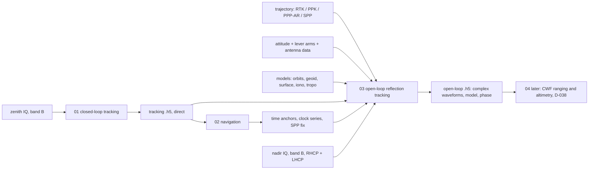

# Plan: notebook 03, open-loop tracking of reflected signals

Status: Draft 2, 2026-11-12. Plan only. No code is written yet. OQ-1 to
OQ-15 are answered (D-087 to D-101); section 13 lists what is still open.
Each item that the `docs/` folder does not settle is marked **[OQ-n]**
and is listed in section 13. Do not build that part until the user
answers it (CLAUDE.md, rule 1).

References (in `04_literature/OpenLoopGNSSR/`):

| Tag | Reference | What this plan takes from it |
| --- | --- | --- |
| [G19] | Gleason 2019, *A Real-Time On-Orbit Signal Tracking Algorithm for GNSS Surface Observations* | Specular-point solver, Snell check, delay relative to the direct signal on a common clock, Doppler model, model interpolation |
| [W21] | Wang, Breitsch, Morton 2021, *SCANF* | OL correlator and phase model, phase unwrapping, dual-frequency Kalman filter with integer slip estimates, C/N0-based measurement noise |
| [B11] | Bai et al. 2012, *GNSS-R open-loop difference phase altimetry* | Direct-referenced OL replica, nav-bit wipe from the direct channel, time-differenced phase altimetry |
| [R26] | Ruf et al. 2026, *Spaceborne GNSS-R ... CYGNSS and future missions* | Coherent and incoherent link equations, DDM definitions, coherent/incoherent classification |
| [Y25] | Yang et al. 2025, *FMERM retracking* | Waveform retracking choices (later option only) |

---

## 1. Purpose and place in the pipeline

Notebook 03 tracks the **reflected** signals in the four GNSS-R channels
(RHCP and LHCP, L1 group and L5 group, `PAYLOAD_ARCHITECTURE.md` section 3).
A closed loop cannot hold lock on a weak, fading, partly diffuse reflection.
So notebook 03 does not use a loop. It **predicts** the delay, Doppler and
carrier phase of the reflection from a model, correlates at the predicted
values, and records the complex correlations. This is open-loop (OL) tracking.

Notebook 03 runs **beside** notebook 01. Notebook 01 tracks the direct
(zenith) channel in closed loop. Notebook 03 tracks the reflected channel of
the same band in open loop and uses notebook 01's output as its reference.



| Item | Notebook 01 | Notebook 03 |
| --- | --- | --- |
| Antenna | Zenith RHCP | Nadir RHCP and LHCP |
| Tracking | Closed loop (DLL, PLL, FLL) | Open loop (model-driven) |
| Acquisition | Full search over code and Doppler | Narrow search around the model (a small DDM) |
| Needs | IQ file | IQ file, notebook 01 file, trajectory, attitude, lever arms, models |
| Writes | `tracking/*.h5` | `openloop/*.h5` |
| Correlator | `bpsk_correlation.correlate__multicomponent` | The same kernel, with model values in, and many delay lags |

Notebook 03 reuses the `Signal` classes, the `CodeSet`, the correlation kernel,
`catalog.select_channel`, the ephemeris code and the time systems. All new logic
goes in `utils/` (architecture rule: notebooks are the application layer).

---

## 2. Coordinate frames, notation and sign conventions

| Symbol | Meaning |
| --- | --- |
| $\mathbf{T}$, $\dot{\mathbf{T}}$ | Transmitter (satellite) antenna phase center, position and velocity, ECEF |
| $\mathbf{R}_Z$, $\mathbf{R}_N$ | Zenith and nadir antenna phase centers (APC), ECEF |
| $\mathbf{S}$ | Specular point, ECEF |
| $\hat{\mathbf{n}}$ | Unit normal of the reflecting surface at $\mathbf{S}$ |
| $e$, $\alpha$ | Elevation and azimuth of the satellite at the specular point |
| $h$ | Height of the nadir APC above the reflecting surface, along $\hat{\mathbf{n}}$ |
| $\rho_D$, $\rho_R$ | Direct and reflected geometric path lengths |
| $\Delta\rho = \rho_R - \rho_D$ | Excess (interferometric) path |
| $f_c$, $\lambda$ | Carrier frequency and wavelength of the band |
| $R_c$, $\ell_c = c/R_c$ | Chip rate and chip length (293.05 m L1 C/A, 29.305 m L5) |
| $T_c$ | Coherent integration time of one OL block |
| $k$ | OL block index; $t_k$ block start time |

Frames: ECEF (WGS84), local NED at the antenna, body frame FRD (forward,
right, down) of the drone. The Euler sequence is ZYX (yaw $\psi$, pitch
$\theta$, roll $\phi$). **[OQ-3]** confirms the frame and Euler convention of
the attitude source.

Sign conventions: notebook 03 must use the same conventions as
`tracking_channel` for `code_phase_ms`, `carr_phase_cycles` and
`doppler_freq_hz`. A unit test with a synthetic signal fixes each sign before
any model is used (section 12, test T-1). In this plan, Doppler is positive
when the path gets shorter: $f = -\frac{1}{\lambda}\frac{d\rho}{dt}$.

---

## 3. Input 1: the receiver trajectory and the antenna phase centers

### 3.1 A trajectory interface that does not care about the method

All position methods give the same thing: a time series of a reference point
with a covariance. Notebook 03 reads it through one interface, so the method can
change without a change to the tracking.

```
Trajectory
  time_gpst_s        (n,)     GPS time of each record
  position_ecef_m    (n, 3)   reference point (see 3.2)
  velocity_ecef_mps  (n, 3)   optional; else differentiated
  covariance_ecef_m2 (n, 3, 3) optional
  quality            (n,)     fix type: fixed / float / single / PPP / ...
  reference_point    str      "ARP" or "APC" of which antenna
  source             str      method and file, for the provenance record
```

Adapters (one small module each, `utils/openloop/trajectory_sources/`):

| Source | Method | File |
| --- | --- | --- |
| Source | Method | File | Version |
| --- | --- | --- | --- |
| RTKLIB `.pos` | PPK (D-040), RTK, PPP, PPP-AR (RTKLIB demo5) | text | First (D-088) |
| Static | A surveyed point (ground or bridge test, `Ground_Test_Sim`) | config | First (D-088) |
| u-blox UBX `NAV-PVT`, `NAV-HPPOSECEF` | RTK in flight (ZED-F9P, D-083) | binary | Later |
| Generic CSV | Any other tool (for example a commercial PPP-AR service) | text, column map in config | Later |
| Notebook 02 solution | SPP from the zenith channel (fallback, low accuracy) | `.h5` | Later |

Rover receiver (D-087): the rover now is the autopilot **Here3**. The team can
add the payload **ZED-F9P** as a PPK rover. Both go through RTKLIB, so the
first version reads both through the `.pos` adapter:

- Here3: raw data from the autopilot log, converted for RTKLIB, if the Here3
  and ArduPilot can log it (not confirmed, see D-087). If they cannot, only the
  autopilot's own position is available. That position is not PPK quality, and
  it would need the CSV adapter.
- F9P: raw UBX (`RXM-RAWX`, `RXM-SFRBX`) → RTKLIB `convbin` → `rnx2rtkp` with
  the ground-station F9P as base → `.pos`.

The `.pos` file must say which point it refers to (the rover antenna ARP or
APC). Config states it (`trajectory.reference_point`), and the lever arm of
that antenna is used in section 3.2.

Interpolation to the OL block times: a cubic Hermite spline in ECEF that uses
the position and the velocity. A 1 Hz PPK solution on a drone is not enough for
the phase model alone, so section 3.4 adds the attitude, and section 8.6 shows
the phase error that the interpolation leaves.

### 3.2 From the reference point to each antenna phase center

The trajectory gives the reference point $\mathbf{P}$ (the APC or the ARP of the
PPK antenna). The lever arms $\mathbf{l}_Z^b$, $\mathbf{l}_N^b$, $\mathbf{l}_P^b$
are measured in the body frame from a body origin. Then, for antenna $A$:

$$
\mathbf{R}_A(t) = \mathbf{P}(t) + C_n^e(\varphi,\lambda)\, C_b^n(\phi,\theta,\psi)\,\big(\mathbf{l}_A^b - \mathbf{l}_P^b\big)
$$

$$
C_b^n = R_z(\psi)\,R_y(\theta)\,R_x(\phi), \qquad
C_e^n = \begin{bmatrix}
-\sin\varphi\cos\lambda & -\sin\varphi\sin\lambda & \cos\varphi\\
-\sin\lambda & \cos\lambda & 0\\
-\cos\varphi\cos\lambda & -\cos\varphi\sin\lambda & -\sin\varphi
\end{bmatrix}, \quad C_n^e = (C_e^n)^T
$$

The velocity of the APC adds the rotation term:

$$
\dot{\mathbf{R}}_A = \dot{\mathbf{P}} + C_n^e C_b^n\big(\boldsymbol{\omega}_{nb}^b \times (\mathbf{l}_A^b - \mathbf{l}_P^b)\big)
$$

The Earth-rate and transport-rate terms are below $10^{-4}$ m/s for these lever
arms. The plan leaves them out and says so in the notebook.

Antenna phase-center offset (PCO) and variation (PCV):

- First version (D-090): the APC is the ARP plus a fixed PCO along the
  boresight (config value per antenna and band, 0 until measured).
- Later, when Q-017 closes: PCO plus PCV as a function of the off-boresight
  angle and the azimuth, from an ANTEX-style table, if a calibration exists.
  For the nadir antenna, the angle is to the specular point, not to the
  satellite.

Sensitivity: an attitude error $\delta\theta$ moves an APC by
$|\mathbf{l}|\,\delta\theta$. With $|\mathbf{l}| = 0.3$ m and
$\delta\theta = 1^\circ$, this is 5 mm. The vertical part enters $\Delta\rho$ as
$2\,\delta h \sin e$.

Attitude source (D-089): the ArduPilot DataFlash log, read after the flight
(`ATT` or `XKF1`). FRD body frame, NED, Euler order ZYX. A constant attitude
from config is the fallback when the log is missing. This does not change
D-012, which is about the payload in flight. The log time must be put on GPS
time; Phase 2 checks how (the log's GPS messages give the tie).

Lever arms (D-091): not measured yet. Config holds null values for the rover
antenna, the zenith antenna and the nadir antenna. The notebook stops with a
clear message until the values are in config. Measure them to about 5 mm from
one body origin.

### 3.3 Time: from sample index to GPS time

The SDR clocks run from a free-running TCXO (D-026). The zenith channel already
gives the time:

$$
t_{GPST}(n) = t_{anchor} + \frac{n - n_{anchor}}{f_s} - \delta t_{rx}(n)
$$

$t_{anchor}$ and $n_{anchor}$ come from notebook 02's decoded time anchor.
$\delta t_{rx}$ comes from `solve_clock_series`. Its sign follows D-105:
$\delta t_{rx} = T - t$, positive when the receiver clock is ahead of GPS time.
This map is the only place where the receiver clock enters the models; no model
adds $\delta t_{rx}$ to a time that came from it. Notebook 03 requires this
notebook 02 output (D-100). The PPS edge (D-025) is a cross-check only. The trajectory and the attitude are interpolated at
$t_{GPST}(n)$.

What accuracy is necessary? In the direct-referenced mode (section 8.1), the
receiver clock cancels in the delay and in the Doppler. The time error only
moves the epoch at which the geometry is evaluated. A drone at 10 m/s with a
1 ms time error has a 1 cm position error. So 1 ms is enough, and notebook 02
gives much better than that. The 14.5 s offset of D-052 shows that the time
must come from the decoded anchor, not from the collect name.

---

## 4. Input 2: satellite positions, velocities and clocks

One interface, two models. Each model returns $\mathbf{T}$, $\dot{\mathbf{T}}$
and the satellite clock at a **transmit** time.

| Model | Source | Accuracy (order) | Existing code |
| --- | --- | --- | --- |
| Rapid | Broadcast ephemeris (decoded, or CDDIS `brdc`/`BRDM`) | 1 m orbit, 1 ns clock | `nav/ephemeris.py`, `broadcast_ephemeris.py`, `rinex3_nav.py` |
| High | Precise SP3 orbit + 30 s CLK clock (final or rapid), satellite PCO from ANTEX | 2-3 cm orbit, 0.1 ns clock | `precise_orbits.py` (SP3; CLK and ANTEX are new) |

Light time and Earth rotation. For each path, solve the transmit time by
iteration:

$$
\tau^{(i+1)} = \frac{1}{c}\,\big|\,R_3(\omega_E \tau^{(i)})\,\mathbf{T}(t_r - \tau^{(i)}) - \mathbf{X}\,\big|
$$

with $\mathbf{X} = \mathbf{R}_Z$ for the direct path and $\mathbf{X} = \mathbf{S}$
for the incident leg of the reflected path. Two or three iterations converge.
The transmit times of the two paths differ by $\Delta\rho/c$ (under 1 µs here),
so the satellite moves less than 4 mm between them. The notebook shows this and
then may use one transmit time for both.

Important result for UAS heights: the satellite position enters $\Delta\rho$
only through the elevation. With $\Delta\rho \approx 2h\sin e$:

$$
\delta(\Delta\rho) \approx 2h\cos e\,\delta e, \qquad \delta e \approx \frac{\delta T_\perp}{|\mathbf{T}-\mathbf{R}|}
$$

A 1 m orbit error at 20 000 km is $5\times10^{-8}$ rad. At $h = 100$ m this is
$10^{-5}$ m. So the **rapid** model is enough for the reflection model. The
**high** model is for the absolute mode (section 8.2), for the PPP solution and
for the comparison plot. The notebook shows both and the difference.

---

## 5. Input 3: the reflecting surface (ellipsoid, geoid, water level, terrain)

### 5.1 Heights

$$
h_{ell}(\varphi,\lambda) = H_{orth}(\varphi,\lambda) + N(\varphi,\lambda)
$$

$N$ is the geoid undulation. $H_{orth}$ is the water level (or terrain height)
above the geoid.

| Model | Geoid | Surface | Notes |
| --- | --- | --- | --- |
| Rapid | One constant $N$ for the flight area (config), taken from GEOID18 at the site | One water level from config | Good when the area is a few km |
| High | GEOID18 grid (D-092); EGM2008 2.5' only outside GEOID18 coverage, with a warning | USGS or agency gauge time series (D-093); DEM (USGS 3DEP) for land | Adds the deflection of the vertical |

Grids and transformations come from `pyproj` and the PROJ grids
(`us_noaa_g2018u0.tif`, `us_nga_egm08_25.tif`), cached in RESOURCES_PATH
(D-094).

Datum chain (D-092, D-093). GEOID18 is a hybrid model: it converts
**NAD83(2011)** ellipsoidal heights to NAVD88 heights. The trajectory is in
ITRF (WGS84). So the height of a point goes through these steps:

$$
\text{ITRF2014 @ epoch} \xrightarrow{\text{14-parameter Helmert (pyproj)}} \text{NAD83(2011)}
\xrightarrow{-N_{\text{GEOID18}}} \text{NAVD88} \xleftarrow{\text{gauge datum offset}} \text{gauge reading}
$$

The ITRF-to-NAD83(2011) step is about 1 m in height and 1 m horizontally in
Colorado. Leaving it out is a 1 m error. The gauge step reads the gauge's
datum; some gauges use NGVD29 or a local datum, and the loader must convert
them to NAVD88 or stop. Do not mix GEOID18 and EGM2008 on one site: they differ
by the NAVD88 bias and tilt (up to about 1 m across CONUS).

**TODO (user, D-092): reference frames of the constellations.** Add the
transformations from GTRF (Galileo) and BDCS (BeiDou, CGCS2000-based) to the
ITRF frame of the trajectory. The broadcast orbits are in these frames. They
agree with ITRF to a few centimetres, so the effect on the reflection model is
below 1 mm (section 4). The effect on the absolute mode and on a multi-system
position is larger. Put the transformation in `sat_states.py`, behind the
provider interface, with the parameters in config. Precise SP3 orbits are
already in IGS20/ITRF for all systems.

Note: when notebook 03 retrieves $h$ (altimetry), the geoid error does not
enter the estimate of $h$. The geoid enters (a) the a-priori model that places
the correlation window, and (b) the conversion of the result to a water level.

### 5.2 Surface normal

- Rapid: the ellipsoid normal at the specular point.
- High: a still water surface is an equipotential surface, so its normal is the
  plumb line. Tilt the ellipsoid normal by the deflection of the vertical
  $(\xi, \eta)$ from the geoid gradient:

$$
\xi = -\frac{1}{M}\frac{\partial N}{\partial \varphi}, \qquad
\eta = -\frac{1}{N_\varphi \cos\varphi}\frac{\partial N}{\partial \lambda}
$$

($M$, $N_\varphi$: meridian and prime-vertical radii). A 10" tilt over a 300 m
horizontal offset is 1.5 cm. The notebook prints the value for the flight area
so the user can see if it matters.

---

## 6. Producing the reflection geometry: the specular point

### 6.1 Rapid model: a flat surface and the image receiver

At UAS heights, the surface near the specular point is a plane with point
$\mathbf{P}_0$ and normal $\hat{\mathbf{n}}$. Mirror the nadir APC in that plane:

$$
h = (\mathbf{R}_N - \mathbf{P}_0)\cdot\hat{\mathbf{n}}, \qquad
\mathbf{R}' = \mathbf{R}_N - 2h\,\hat{\mathbf{n}}
$$

The reflected path is a straight line from $\mathbf{T}$ to the image:

$$
\rho_R = |\mathbf{T} - \mathbf{R}'|, \qquad
\mathbf{S} = \mathbf{R}' + s(\mathbf{T} - \mathbf{R}'), \quad
s = \frac{(\mathbf{P}_0 - \mathbf{R}')\cdot\hat{\mathbf{n}}}{(\mathbf{T} - \mathbf{R}')\cdot\hat{\mathbf{n}}}
$$

The horizontal distance from the sub-receiver point to $\mathbf{S}$ is
$d = h/\tan e$ along the azimuth. This is closed-form, so it is fast. It is
exact for a plane.

The excess path, with the satellite far away and one antenna:

$$
\Delta\rho = \rho_R - \rho_D \approx 2h\sin e
$$

With two antennas, the zenith-to-nadir lever arm adds a term:

$$
\Delta\rho = |\mathbf{T} - \mathbf{R}'_N| - |\mathbf{T} - \mathbf{R}_Z|
\approx 2h_N \sin e + \hat{\mathbf{u}}_T\cdot(\mathbf{R}_Z - \mathbf{R}_N)
$$

($\hat{\mathbf{u}}_T$: unit vector to the satellite.) The second term is a few
decimetres and changes with the attitude. Do not leave it out.

### 6.2 High-accuracy model: a curved surface

The plane is wrong by the Earth curvature. The surface drops by
$d^2 / (2R_E)$ at the distance $d$. At $h = 100$ m and $e = 5^\circ$,
$d = 1.14$ km and the drop is 0.10 m. That is not small for carrier-phase
altimetry. So the high model uses the iterative solver of [G19] on the surface
of section 5:

$$
\mathbf{dS}_i = \frac{\mathbf{T} - \mathbf{S}_i}{|\mathbf{T} - \mathbf{S}_i|} + \frac{\mathbf{R}_N - \mathbf{S}_i}{|\mathbf{R}_N - \mathbf{S}_i|},
\qquad \mathbf{S}_{i+1} = \mathbf{S}_i + K\,\mathbf{dS}_i
$$

then project $\mathbf{S}_{i+1}$ back onto the surface. [G19] scales by the
geocentric radius (eq. 8-9). The plan uses a better projection: convert to
geodetic coordinates, set the height to $h_{ell}(\varphi,\lambda)$, and convert
back. This handles the geoid and a DEM.

Start values: the rapid image solution (section 6.1). It is already within
centimetres at UAS heights, so the solver needs one to three iterations, not
the hundreds that a LEO start needs. Also use the last epoch's point plus the
specular-point velocity ([G19] eq. 22).

Stop test, from Snell's law ([G19] eq. 14), with the local normal
$\hat{\mathbf{n}}$ in place of $\mathbf{S}/|\mathbf{S}|$:

$$
\delta = \cos^{-1}(\hat{\mathbf{D}}_{RS}\cdot\hat{\mathbf{n}}) - \cos^{-1}(\hat{\mathbf{D}}_{TS}\cdot\hat{\mathbf{n}}),
\qquad |\delta| < \delta_{tol}
$$

[G19] uses $0.1^\circ$ for DDM targeting. Carrier-phase work needs a much
smaller value. Set $\delta_{tol}$ from the required path accuracy: near the
specular point the path is stationary, so a position error $\epsilon$ of
$\mathbf{S}$ along the surface changes $\rho_R$ only to second order. The
notebook shows $\rho_R$ against the iteration count and picks the tolerance
from that plot.

### 6.3 What else this section computes

- Fresnel zone axes at the specular point (first zone):
  $b \approx \sqrt{\lambda h / \sin e}$, $a \approx b/\sin e$.
  (`Specular_Planner/engine/geometry.py:fresnel_axes` has this; reuse or copy.)
- The angle from the nadir antenna boresight to $\mathbf{S}$, and the antenna
  gain toward $\mathbf{S}$ (needs [OQ-4]).
- A coherence expectation from the Rayleigh criterion: coherent when
  $\sigma_s < \lambda / (8\sin e)$ ($\sigma_s$: surface RMS height).
- A satellite selection table: elevation, gain at $\mathbf{S}$, whether
  $\mathbf{S}$ falls on water (water mask from `Specular_Planner` data), and the
  predicted SNR (section 9.1).

---

## 7. Input 4: the propagation models

The models matter in a different way for the two model modes (section 8).
The table gives both.

| Effect | Rapid model | High-accuracy model | Size on the direct path | Size on $\Delta\rho$ (UAS) |
| --- | --- | --- | --- | --- |
| Ionosphere | NeQuick-G for all constellations (D-095); Klobuchar and BDGIM stay as options | IONEX GIM (`gnss_tools.rinex_io.ionex` exists), or L1/L5 dual frequency from the two zenith channels | 2-30 m | ≈ 0 (see 7.1) |
| Troposphere | Saastamoinen with a standard atmosphere (`observables.saastamoinen_delay_m` exists) | GPT3 (ZHD, ZWD, $N_0$) with VMF3 or GPT3 mapping; no met sensor (D-096) | 2.3-25 m | cm to dm (see 7.2) |
| Satellite orbit and clock | Broadcast | SP3 + CLK | 1 m | ≈ 0 (section 4) |
| Relativity, Sagnac | Always on | Always on | 10-30 m | ≈ 0 |

### 7.1 Ionosphere on the excess path

The extra leg of the reflected path is under the drone (below 120 m). It has no
free electrons. The two rays cross the ionosphere (300-450 km) less than 2 km
apart. So the ionospheric part of $\Delta\rho$ is zero to well under 1 mm. The
ionosphere matters only for (a) the absolute mode, (b) the direct-signal
position solution, and (c) the dual-frequency filter of section 10.3, where it
means one state can be removed. The notebook prints this term from the chosen
model to show it is negligible.

### 7.2 Troposphere on the excess path

The extra leg is in the densest air. A first-order model (no ray bending, a
constant surface refractivity $N_0$ over the height $h$):

$$
\Delta\rho_{trop} \approx \big[T(0) - T(h)\big] + 10^{-6}N_0\,\frac{h}{\sin e}
\approx 2\cdot 10^{-6}N_0\,\frac{h}{\sin e}
$$

Here $T(z)$ is the slant tropospheric delay from height $z$ at elevation $e$.
This is the delay part. It biases the height by

$$
\frac{\delta h}{h} \approx \frac{10^{-6}N_0}{\sin^2 e}
$$

With $N_0 = 300$: 0.3 % at $30^\circ$ and about 1 % at $10^\circ$. At $h = 50$ m
and $10^\circ$ this is about 0.5 m of height. It is the largest model term for
low-elevation altimetry. **This first-order value must be checked** against a
ray-traced model (Nievinski and others, GNSS-IR literature; not in the reference
folder) before it is trusted. Ray bending reduces it at low elevation.

Rapid: $N_0$ from a standard atmosphere at the surface height.
High: $N_0$ from GPT3 at the site and day of year, plus the bending term.
There is no met sensor (D-096). A met-file input can be added later behind the
same interface.

### 7.2a NeQuick-G as the rapid ionosphere (D-095)

NeQuick-G gives the electron density $N_e(\mathbf{x}, t)$. The slant TEC is the
integral along the straight line from the transmitter to the receiver:

$$
\mathrm{STEC} = \int_{\mathbf{R}}^{\mathbf{T}} N_e(\mathbf{x}, t)\, ds,
\qquad
I_f = \frac{40.3\,\mathrm{STEC}}{f^2}\ \text{(m, group delay; the phase advances by the same amount)}
$$

Inputs: the receiver and transmitter positions, the time (month and universal
time), and the effective ionisation level
$Az = a_{i0} + a_{i1}\mu + a_{i2}\mu^2$ ($\mu$: modified dip latitude). The
coefficients $a_{i0..2}$ come from the Galileo broadcast message (F/NAV or
I/NAV) or from the RINEX 3 navigation header (`GAL` ionospheric line). For a
run with no Galileo data, the code reads them from the CDDIS `BRDM` file of the
day (`rinex3_nav.py`). The reference implementation is the EU "NeQuick G"
algorithm document; test against its published check values.

Cost: NeQuick-G integrates along the path, so it is slower than Klobuchar. It
is computed at the model anchor rate (section 8.5), not per block.

### 7.3 Where the models plug in

`utils/openloop/atmosphere.py` holds one interface for each effect:
`delay_m(t, receiver_ecef, sat_ecef, band) -> float`, and a second method
`excess_delay_m(...)` for the reflected-minus-direct term. Config picks the
model by name (section 11). The notebook runs the rapid and the high model and
plots the difference, as notebook 02 does for its corrections.

---

## 8. Producing the open-loop model (delay, Doppler, phase)

### 8.1 Mode A (recommended): direct-referenced model

The zenith and nadir channels share one 10 MHz reference and one PPS (D-025).
So, as in [G19] section 4.1 and [B11], predict the reflection **relative to the
tracked direct signal** of the same satellite and band. The receiver clock, the
satellite clock, the ionosphere and most of the troposphere cancel.

Code delay (seconds):

$$
\tilde\tau_R(t) = \tau_D(t) + \frac{\Delta\rho(t) + \Delta\rho_{trop}(t)}{c} + \tau_{hw}
$$

Doppler (Hz):

$$
\tilde f_R(t) = f_D(t) - \frac{1}{\lambda}\,\frac{d}{dt}\big[\Delta\rho(t) + \Delta\rho_{trop}(t)\big]
$$

Carrier phase (cycles):

$$
\tilde\phi_R(t) = \phi_D(t) - \frac{\Delta\rho(t) + \Delta\rho_{trop}(t)}{\lambda} + \phi_{hw}
$$

The ionosphere delays the code and advances the carrier by the same amount
(D-105). An excess ionosphere $\Delta\rho_{iono}$ therefore enters as
$+\Delta\rho_{iono}/c$ in the code delay and as $+\Delta\rho_{iono}/\lambda$ in the
carrier phase (it is subtracted from the phase excess). The model keeps a group
excess $D_g = \Delta\rho + \Delta\rho_{trop} + \Delta\rho_{iono}$ for the code and a
phase excess $D_p = \Delta\rho + \Delta\rho_{trop} - \Delta\rho_{iono}$ for the
carrier and the Doppler. The excess ionosphere is zero here (section 7.1), so
$D_g = D_p$ in practice.

$\tau_D$, $f_D$, $\phi_D$ come from the notebook 01 file of the zenith channel.
$\tau_{hw}$ and $\phi_{hw}$ are the inter-channel hardware delay and phase
(cables, filters, different SDRs). They are calibrated (section 9.4).

The excess Doppler, from $\Delta\rho \approx 2h\sin e$:

$$
f_R - f_D \approx -\frac{2}{\lambda}\big(\dot h\sin e + h\cos e\,\dot e\big)
$$

$\dot e$ is about $10^{-4}$ rad/s for a MEO satellite. At $h = 50$ m the second
term is about 0.05 Hz. The drone's vertical rate dominates: 1 m/s at $30^\circ$
gives about 5 Hz at L1. Attitude motion adds the lever-arm rate of section 3.2.

Exact (not approximate) Doppler, with the image of section 6.1 (the surface does
not move):

$$
\dot{\mathbf{R}}' = \dot{\mathbf{R}}_N - 2(\dot{\mathbf{R}}_N\cdot\hat{\mathbf{n}})\hat{\mathbf{n}}, \quad
\frac{d\rho_R}{dt} = \hat{\mathbf{u}}_{R'T}\cdot(\dot{\mathbf{T}} - \dot{\mathbf{R}}'), \quad
\frac{d\rho_D}{dt} = \hat{\mathbf{u}}_{ZT}\cdot(\dot{\mathbf{T}} - \dot{\mathbf{R}}_Z)
$$

This equals [G19] eq. 19-21 with the clock term taken from the direct channel.

Navigation data and secondary codes: $\Delta\rho/c$ is under 1 µs at UAS
heights. So the reflected signal has the same data bit and overlay chip as the
direct signal at the same time. Notebook 03 takes the bit edges, the bit signs
and the overlay counter from the notebook 01 file ([B11]).

Code-phase ambiguity: $\Delta\rho$ is much shorter than any code period, so the
modulo step of [G19] eq. 18 is only a wrap of the code phase into the period.

The L1 group and the L5 group are on different SDRs, each with its own zenith
channel. Each band uses the zenith channel of its own band as the reference.

### 8.2 Mode B (cross-check): absolute model

As [W21] eq. 6-7, in the signal model of D-105: compute $\rho_R$ from the orbits
and the trajectory, and predict the code phase as the transmit time,

$$
\chi_B = 10^3\left(t - \frac{\rho_R + I_R + T_R}{c} - \tau_{grp}
       + \delta t_{tx}\!\left(t - \frac{\rho_R}{c}\right)\right),
$$

with $t$ the GPS time of the samples (section 3.3), $I_R$ and $T_R$ the FULL
ionosphere and troposphere of the reflected path (not the excess), $\tau_{grp}$
the satellite group delay and $\delta t_{tx}$ the satellite clock at the transmit
time. The receiver clock is inside $t$; it is not added again. This mode needs
the high-accuracy models. It does not need the direct channel during the
reflection (useful when the zenith signal is blocked). The notebook runs it once
to show Mode A minus Mode B, which must be a constant. The receiver-clock noise
of the notebook 02 series and the TCXO jitter appear in that difference; this is
why Mode A is the default. Only the Mode B code phase is built (C-15).

### 8.3 Risk: different SDRs have different local oscillators

The zenith channel is on a B200. The nadir channels are on a B210 (section 3 of
`PAYLOAD_ARCHITECTURE.md`). They share the 10 MHz reference, but each AD9361
synthesizes its own LO. The LO phase difference is random at each tune and can
drift with temperature. A constant part goes into the carrier ambiguity. A drift
goes into $\phi_{hw}(t)$ and looks like a height change.

Decision (D-097): the B200 and the B210 use the same external 10 MHz and PPS.
Notebook 03 treats them as one frequency reference, and no bench test is
planned now. The common reference removes any frequency difference. The
random LO phase at each tune is a constant, and it goes into the carrier
ambiguity. Only a slow phase wander is left, and it is not measured.

Check on real data: the direct signal leaks into the nadir antenna through its
back lobe. That leakage is on the **same B210** as the reflection. Section 9.3
estimates the leakage as a complex gain $\beta(t)$ times the zenith
correlation. The phase of $\beta(t)$ follows the B200-to-B210 LO phase. The
notebook plots $\arg\hat\beta(t)$. A flat line confirms D-097; a trend shows a
wander that must be removed before the height fit.

### 8.4 From the continuous model to the correlator inputs

The kernel `correlate__multicomponent` takes, for one block: an initial carrier
phase, one Doppler, one code rate, one initial code phase, and an array of delay
lags. So the model is evaluated per block $k$ (length $T_c$, aligned with the
direct channel's epochs):

$$
\phi_k = \tilde\phi_R(t_k), \quad
f_k = \tilde f_R\!\left(t_k + \tfrac{T_c}{2}\right), \quad
\tau_k = \tilde\tau_R(t_k), \quad
\dot\tau_k = 1 + \frac{f_k}{f_c} \ \ \text{(carrier-aided code rate)}
$$

The block keeps $\phi_k$, $f_k$ and $\tau_k$ in the output file. The total
phase is rebuilt later as $\hat\phi = \phi_k + \delta\phi_k$ ([W21] eq. 9,
[B11] eq. 9).

### 8.5 Model rate and interpolation

The geometry changes slowly, but the drone and its attitude change faster.
Evaluate the full model at a grid of anchor times (for example 50 Hz, config),
then interpolate $\Delta\rho$ with a cubic spline to each block. Differentiate
the spline for the Doppler, so the phase and the Doppler stay consistent. This
is [G19] section 7.3 applied to a post-processing case.

### 8.6 Error budget (example: $h = 50$ m, L1, $e = 30^\circ$)

| Error source | Effect on $\Delta\rho$ | RTK/PPK (2 cm, 0.5°) | SPP (5 m) |
| --- | --- | --- | --- |
| Vertical position $\sigma_U$ | $2\sigma_U\sin e$ | 2 cm | 5 m |
| Horizontal position (flat water) | 0 | 0 | 0 |
| Attitude × lever arm | $|\mathbf{l}|\,\delta\theta$ | 3 mm | 3 mm |
| Velocity $\sigma_{v,U}$ (Doppler) | $2\sigma_{v,U}\sin e/\lambda$ | 0.1 Hz (at 2 cm/s) | 5 Hz (at 1 m/s) |
| Orbit (broadcast) | $2h\cos e\,\delta e$ | < 0.1 mm | < 0.1 mm |
| Troposphere (if not modelled) | section 7.2 | 6 cm | 6 cm |
| Geoid or water level | $2\,\delta N\sin e$ (model only) | config | config |

Requirements for the OL window and loss:

- Delay: $|\delta\tau| < 0.25$ chip for a DDM ([G19]). L1 C/A: 73 m. L5: 7.3 m.
  SPP is enough for L1 C/A, marginal for L5. RTK or PPK is enough for both.
- Doppler: the coherent loss is $\operatorname{sinc}^2(\pi\,\delta f\,T_c)$
  ([B11] eq. 4-5). For under 1 dB loss at $T_c = 20$ ms, $|\delta f| < 13$ Hz.
- Phase: the model must not let the residual phase move more than about
  $0.25$ cycle per block, or the unwrapping in section 10.2 slips. So
  $|\delta f|\,T_c < 0.25$: at 20 ms, $|\delta f| < 12.5$ Hz. The residual
  must also be smooth over many blocks for the filter.

The notebook prints this table for the real flight from the trajectory
covariance. The example height and elevation are only for this text. Flight
height and mask have no default (D-099): the notebook takes $h(t)$ from the
trajectory and the mask from config, and sizes the lag window from them:

$$
\tau_{\min} = -\Delta_\tau, \qquad
\tau_{\max} = \frac{2\,h_{\max}}{\ell_c} + \Delta_\tau
$$

(in chips, relative to the direct-signal code phase; $\Delta_\tau$ from the
model uncertainty and $\tau_{hw}$). The 2 cm column assumes a fixed dual-frequency PPK solution
(F9P). A single-frequency rover (Here3, if it is an M8P, D-087) fixes less
often and less quickly. With float or single-point epochs the L5 delay window
and the phase model get worse; the notebook flags epochs by fix quality.

---

## 9. Acquiring the reflection

"Acquisition" here does not search all code phases and Doppler bins as
notebook 01 does. It checks that the reflection is where the model says, and
measures the small offsets that the model does not know.

### 9.1 Expected signal level

Coherent (specular) case, from [R26] eq. 2, with the Fresnel reflection
coefficient and a roughness loss:

$$
P_{coh} = \frac{P_T G_T \lambda^2 G_R}{(4\pi)^2 (\rho_{TS} + \rho_{SR})^2}\,
|\mathcal{R}_{pq}(e)|^2\, e^{-(2k\sigma_s \sin e)^2}
$$

with $k = 2\pi/\lambda$. Circular-polarization coefficients from the linear
Fresnel coefficients:

$$
\mathcal{R}_{RR} = \tfrac12(\mathcal{R}_{vv} + \mathcal{R}_{hh}), \qquad
\mathcal{R}_{RL} = \tfrac12(\mathcal{R}_{vv} - \mathcal{R}_{hh})
$$

$$
\mathcal{R}_{vv} = \frac{\varepsilon\sin e - \sqrt{\varepsilon - \cos^2 e}}{\varepsilon\sin e + \sqrt{\varepsilon - \cos^2 e}}, \qquad
\mathcal{R}_{hh} = \frac{\sin e - \sqrt{\varepsilon - \cos^2 e}}{\sin e + \sqrt{\varepsilon - \cos^2 e}}
$$

$\varepsilon$ is the complex permittivity of the surface (fresh water at L-band:
about $80 - j\,5$, config). Above the Brewster angle (about $6^\circ$ to $7^\circ$
for water) the reflection is mostly LHCP; below it, mostly RHCP. This drives the
RHCP and LHCP comparison of D-041. The notebook plots $|\mathcal{R}_{RR}|^2$ and
$|\mathcal{R}_{RL}|^2$ against elevation and marks each tracked satellite.

The expected C/N0 then sets the coherent time and the number of incoherent sums
(section 9.2).

### 9.2 A small delay-Doppler map around the model

For block $k$, lag $\tau_j$ and Doppler offset $f_m$:

$$
Z_k(\tau_j, f_m) = \sum_{n \in k} x[n]\; c\!\left(t_n - \tilde\tau_R - \tau_j\right) d_k\;
e^{-j2\pi\left[\tilde\phi_R(t_n) + f_m (t_n - t_k)\right]}
$$

$$
Y(\tau_j, f_m) = \frac{1}{N_i}\sum_{k=1}^{N_i} \left| Z_k(\tau_j, f_m) \right|^2
$$

Window: lags from $-\Delta_\tau$ to $+\Delta_\tau$ with a step of 0.05 to 0.1 chip,
where $\Delta_\tau$ covers $3\sigma_\tau$ of the model plus the unknown
$\tau_{hw}$. Doppler: a few bins of width $1/(2T_c)$; often one bin is enough
because the Doppler model is good to under 1 Hz with RTK/PPK.

Noise floor $\hat\sigma_N^2$: the mean of $Y$ at lags far from both the
reflection and the direct leakage (more than 2 chips away; for L1 C/A that means
lags before $-2$ chips). Detection SNR: $(Y_{max} - \hat\sigma_N^2)/\hat\sigma_N^2$.

Threshold: under noise only, $N_i\,Y/\sigma_N^2$ follows a Gamma (chi-square,
$2N_i$ degrees of freedom) law. For a total false-alarm probability
$p_{fa}$ over $J$ lags and $M$ bins:

$$
\gamma = \frac{\sigma_N^2}{N_i}\; F^{-1}_{\Gamma(N_i,1)}\!\left(1 - \frac{p_{fa}}{J M}\right)
$$

This is the same logic as `bpsk_acquisition` and D-085. Reuse that code, do not
copy it.

### 9.3 The direct signal in the nadir antenna

At UAS heights, the reflection is very close to the direct signal in delay:

| Band | Chip length | Delay separation $2h\sin e$ at $h=50$ m, $e=30^\circ$ | Resolved? |
| --- | --- | --- | --- |
| L1 C/A | 293 m | 50 m = 0.17 chip | No |
| L5, E5a, B2a | 29.3 m | 50 m = 1.7 chip | Yes |
| L1C, B1C (BOC) | 293 m | 0.17 chip | No (BOC side peaks help a little) |

and in Doppler (a few Hz, section 8.1). So the leakage of the direct signal into
the nadir antenna sits on top of the reflection for the L1 group. It produces the
interference pattern that GNSS-IR uses, but here it is an error. The two
polarization channels see it at different levels (RHCP more than LHCP).

Model of one nadir-channel correlation at the reflection lag:

$$
Z_k^{N} = \beta\, Z_k^{Z,\,\text{shifted}} + a_k e^{j\delta\phi_k} + w_k
$$

$Z_k^{Z,\text{shifted}}$ is the zenith correlation, recomputed with the nadir
replica (same block, same lag, through the zenith IQ). Because the clocks are
common, $\beta$ is a slowly varying complex coupling. Estimate $\beta$ by least
squares over a window $W$ long enough that the reflection phase $\delta\phi_k$
rotates many times (the interferometric frequency is $f_R - f_D$):

$$
\hat\beta = \frac{\sum_{k\in W} Z_k^{N}\,\overline{Z_k^{Z}}}{\sum_{k\in W} |Z_k^{Z}|^2}
$$

When $f_R - f_D$ is near zero (a level drone and a slow satellite), $\beta$ and
the reflection cannot be separated; the notebook flags these windows. The phase
of $\hat\beta$ also gives the LO phase check of section 8.3.

First version (D-098): estimate $\hat\beta$, plot $|\hat\beta|$ and
$\arg\hat\beta$, and flag the epochs where
$|\hat\beta Z_k^{Z}|^2$ is larger than a config fraction of the reflection
power. Do **not** subtract it yet. The subtraction ($Z_k^{N} - \hat\beta Z_k^{Z}$)
is later work.

### 9.4 Calibrating the hardware delay and phase

$\tau_{hw}$: the lag of the DDM peak (refined between the grid lags by a parabola
through the top three lags, or by early-late equality $A(x-d) = A(x+d)$; config
`acquisition.peak_method`, D-103) minus the model, averaged over high-SNR
satellites.
It is common to all satellites of one band and one channel. A large
satellite-dependent residual means a geometry error, not a hardware delay.

$\phi_{hw}$: not observable alone. It goes into the carrier ambiguity. Only its
drift matters (section 8.3).

Retracking choices for the code delay: peak, maximum of the derivative (leading
edge), or a fit of the model waveform. [Y25] adds a learned retracker; this plan
leaves that for later.

---

## 10. Tracking the reflection (open loop)

### 10.1 The correlator loop

For each block $k$ of length $T_c$ (1 ms for L1 C/A, aligned with the direct
channel's epochs and bit edges):

1. Read the model values $\phi_k, f_k, \tau_k, \dot\tau_k$ (section 8.4).
2. Run `correlate__multicomponent` with a lag array (for example $-2$ to $+4$
   chips, step 0.05 chip; config). The output is the complex waveform
   $Z_k(\tau_j)$ for each code component.
3. Wipe the data and the overlay with $d_k$ from the notebook 01 file. For
   signals with a pilot (L5Q, L1CP, B2a pilot, B1C pilot, E5a-Q), use the pilot
   and its overlay; then no data wipe is needed and longer coherent sums are
   possible.
4. Sum $N_c$ blocks coherently to $T_{coh} = N_c T_c$ (for example 20 ms).
   The limit is the surface coherence time and the residual phase rate.
5. Store $Z(\tau_j)$ at $T_{coh}$ and at $T_c$ (config), the model values, and
   the direct reference values.

Both polarization channels of one band use the same model and the same block
grid, so their waveforms line up sample for sample.

This step does not change the model from the data. That is what "open loop"
means here. A second pass (section 10.5) may update the slow terms.

### 10.2 Residual phase and unwrapping

At the reflection lag $\tau^\ast$ (the retracked peak, or the model lag plus
$\tau_{hw}$):

$$
\delta\phi_k^{w} = \operatorname{atan2}\!\big(\operatorname{Im} Z_k(\tau^\ast), \operatorname{Re} Z_k(\tau^\ast)\big)
$$

Four-quadrant phase is allowed because the data is already wiped ([W21]). This
removes half-cycle slips. Unwrap with an integer $m_k$:

$$
\delta\phi_k = \delta\phi_k^{w} + 2\pi m_k, \qquad
m_k = \operatorname{round}\!\left(\frac{\delta\hat\phi_{k|k-1} - \delta\phi_k^{w}}{2\pi}\right)
$$

[B11] and [W21] use the previous value as the prediction. The plan uses the
filter prediction $\delta\hat\phi_{k|k-1}$ of section 10.3, which slips less in a
fade. The measured excess path is

$$
\Delta\hat\rho_k = \Delta\tilde\rho_k - \frac{\lambda}{2\pi}\,\delta\phi_k
$$

(sign to be fixed by test T-1).

### 10.3 Filtering: SCANF adapted to a drone

[W21] uses the state $[\,\psi_{L1}, \psi_{L2}, \dot s, \dot i\,]$. At UAS heights
the dispersive (ionospheric) part of the excess path is zero (section 7.1). So
the plan uses a smaller state: one non-dispersive excess-path residual and its
rate (and, optionally, its acceleration for drone motion), common to L1 and L5:

$$
\mathbf{x}_k = \begin{bmatrix} r_k \\ \dot r_k \end{bmatrix}, \qquad
\mathbf{x}_{k+1} = \begin{bmatrix} 1 & T \\ 0 & 1 \end{bmatrix}\mathbf{x}_k + \mathbf{w}_k
$$

$$
\mathbf{y}_k = \begin{bmatrix} -\tfrac{\lambda_1}{2\pi}\delta\phi_{1,k} \\ -\tfrac{\lambda_5}{2\pi}\delta\phi_{5,k} \end{bmatrix}
= \begin{bmatrix} 1 & 0 \\ 1 & 0 \end{bmatrix}\mathbf{x}_k
+ \begin{bmatrix} \lambda_1 m_{1,k} \\ \lambda_5 m_{5,k} \end{bmatrix}
+ \mathbf{v}_k
$$

Measurement noise from the C/N0 of each block ([W21] eq. 17):

$$
\sigma_{i,k}^2 = \left(\frac{\lambda_i}{2\pi}\right)^2 \frac{1}{2T\,(C/N_0)_{i,k}}\left(1 + \frac{1}{2T\,(C/N_0)_{i,k}}\right)
$$

C/N0 per block ([W21] eq. 18): $|Z_k(\tau^\ast)|^2 / (\hat\sigma_N^2 T)$, with
$\hat\sigma_N^2$ from the far lags (section 9.2). In a fade the variance grows,
and the filter coasts on its prediction.

Integer slip update after each prediction ([W21] eq. 23):

$$
(m_{1,k}, m_{5,k}) = \arg\min_{m_1, m_5}\ \big\| \mathbf{y}_k - H\mathbf{x}_k^- - (\lambda_1 m_1, \lambda_5 m_5)^T \big\|_{R_k^{-1}}
$$

The search is small (for example $m_i \in \{-2,\dots,2\}$ around the last value).
Then the normal Kalman update ([W21] eq. 24-27).

Why dual frequency helps: a slip on one band only changes $y_1 - y_5$ by
$\lambda_1$ or $\lambda_5$, while a real height change does not change it. The
wide-lane wavelength $\lambda_{WL} = c/(f_1 - f_5) = 0.751$ m gives a robust
check. This needs the L1 and L5 OL runs on the same block grid in time; the
merge is in section 10.4.

Process noise $Q$: from the expected vertical acceleration of the drone and the
trajectory error spectrum. Tune it on the synthetic test (T-6) and on a static
test.

The single-frequency case (L1 only or L5 only) runs the same filter with one
row.

### 10.4 Coherence check and data selection

Run the phase steps only where the reflection is coherent ([W21] says the
coherence test comes first). Use two metrics per window of $N$ blocks:

$$
\kappa = \frac{\left|\sum_k Z_k(\tau^\ast)\right|^2}{N \sum_k |Z_k(\tau^\ast)|^2} \in [0, 1]
$$

and the width of the waveform $|Z(\tau)|^2$ against the ideal correlation shape
(diffuse scattering widens it, [R26]). Windows below the thresholds (config) get
a flag and no phase output.

### 10.5 Optional second pass

After pass 1, fit a slowly varying correction to the model (for example a
constant height bias per surface, and $\tau_{hw}$). Rebuild the model and run the
correlator again. This shrinks the residual phase rate and lowers the slip rate.
It is still open loop, because the correction is fixed before pass 2 begins.

---

## 11. Observables, outputs and configuration

### 11.1 Observables in the notebook

1. Excess code delay $c(\hat\tau_R - \tau_D) - c\,\tau_{hw}$ per satellite:
   absolute, noisy.
2. Excess carrier path $\Delta\hat\rho$ per satellite: precise, with one
   ambiguity per continuous arc.
3. Height above the surface. Per satellite and arc:
   $\Delta\hat\rho - \Delta\tilde\rho = 2\,\delta h\sin e + b$; solve $\delta h$
   (and its rate) and $b$ by least squares. Across satellites: one common
   $\delta h$, one $b$ per arc. This is the time-differenced method of [B11]
   eq. 13 written as a least-squares problem.
4. Water level: $H_{orth} = h_{ell}(\mathbf{R}_N) - h - N$.
5. RHCP and LHCP power and phase against elevation (D-041).

Notebook 04 (later) combines 1 and 2 with CWF (D-038). The output format keeps
every complex waveform so CWF can use it.

### 11.2 Output file `openloop/*.h5`

Per satellite, per channel (RHCP, LHCP), per block:

- time: sample index, GPST.
- model: $\tilde\tau_R$, $\tilde f_R$, $\tilde\phi_R$, $\Delta\tilde\rho$,
  $\Delta\rho_{trop}$, $e$, $\alpha$, $h$, $\mathbf{S}$ (lat, lon, h), Snell
  residual.
- direct reference: $\tau_D$, $f_D$, $\phi_D$, $d_k$.
- waveforms: $Z_k(\tau_j)$ (complex64), lag grid.
- products: C/N0, $\kappa$, $\delta\phi^w$, $m$, filtered state, slip flags,
  leakage estimate $\hat\beta$.
- provenance: config, model names (rapid or high for each), input file paths and
  hashes, git commit (as `tracking_io` does).

### 11.3 Configuration: `configs/openloop.yml`

No hard-coded values (CLAUDE.md, rule 5). Sketch:

```yaml
trajectory:
  source: rtklib_pos          # rtklib_pos | static  (D-088); ubx | csv | nb02 later
  path: ...
  rover: here3                # here3 | zed_f9p  (D-087)
  reference_point: ARP_rover  # which point the solution refers to
attitude:
  source: ardupilot_log       # ardupilot_log | constant  (D-089)
  message: ATT                # ATT | XKF1
  euler_convention: ZYX_FRD_NED
  constant_rpy_deg: null      # used only when source = constant
antennas:                     # FRD body-frame lever arms, metres (D-091: null until measured)
  rover:  {lever_arm_b: null, pco_m: {L1: 0.0}}            # D-090: fixed PCO
  zenith: {lever_arm_b: null, pco_m: {L1: 0.0, L5: 0.0}}
  nadir:  {lever_arm_b: null, pco_m: {L1: 0.0, L5: 0.0}}
models:
  orbits: broadcast            # broadcast | precise
  geoid: geoid18               # geoid18 | egm2008 (fallback) | constant | none  (D-092)
  frames: {trajectory: ITRF2014, geoid_ellipsoid: NAD83_2011}  # pyproj (D-094)
  surface: water_level         # ellipsoid | geoid | water_level | dem
  ionosphere: nequick_g        # nequick_g | klobuchar | bdgim | ionex | dual_frequency | none  (D-095)
  troposphere: saastamoinen    # saastamoinen | gpt3_vmf3 | gpt3 | none  (D-096)
  specular: image_plane        # image_plane | iterative_curved
  model_mode: direct_referenced  # direct_referenced | absolute
openloop:
  model_rate_hz: 50
  block_ms: 1
  coherent_ms: 20
  lags_chips: {start: -2.0, stop: 4.0, step: 0.05}
  noise_lags_chips: {start: -8.0, stop: -4.0}
acquisition:
  incoherent_blocks: 50
  p_fa_total: 1.0e-3
phase:
  filter: scanf_nondispersive
  slip_search: 2
  coherence_min: 0.5
calibration:
  tau_hw_ns: {L1_RHCP: null, L1_LHCP: null, L5_RHCP: null, L5_LHCP: null}
surface:
  permittivity: [80.0, -5.0]
  water_level_m: ...           # placeholder until the gauge is chosen
  gauge: {source: usgs_nwis, site_id: null, datum: NAVD88}  # D-093
```

A loader validates every value and stops with a clear message when one is bad
or missing.

---

## 12. Notebook outline, modules, tests and build order

### 12.1 Notebook sections (same style as 01 and 02)

| § | Title | Content |
| --- | --- | --- |
| 0 | 03 – Open-loop tracking of reflected signals | What it does, inputs and outputs, when not to use it |
| 1 | Imports | |
| 2 | Configuration | 2.1 reflected channel and direct run; 2.2 trajectory; 2.3 antennas and attitude; 2.4 model choices; 2.5 surface; 2.6 OL grid; 2.7 acquisition; 2.8 phase |
| 3 | Load the inputs and line up the time | Direct `.h5`, notebook 02 anchors, trajectory, attitude. Plot: time offsets, trajectory quality |
| 4 | Where the antennas were | Lever arms and attitude to the three APCs. Plot: APC heights, effect of the attitude |
| 5 | Where the satellites were | Rapid and high orbits, light time, the difference and why it does not matter here |
| 6 | The reflecting surface and the specular points | Geoid, water level, normal; image solution and curved solution; Snell residual; Fresnel zones on a map; satellite selection |
| 7 | The atmosphere on the two paths | Ionosphere and troposphere, rapid and high, absolute and excess; the 7.2 height bias table |
| 8 | Producing the model | Mode A equations; plots of excess delay, Doppler and phase against the direct signal; Mode A minus Mode B; the error budget for this flight |
| 9 | Acquiring the reflection | Expected power and Fresnel coefficients; the small DDM; detection; $\tau_{hw}$; direct leakage |
| 10 | Tracking in open loop | The correlator run; waveforms against time; RHCP and LHCP |
| 11 | Phase | Unwrap, coherence, SCANF, slips; dual-frequency check |
| 12 | Observables | Excess delay and path, height above the surface, water level against truth |
| 13 | Save the results | `openloop/*.h5` |
| – | Exercises; Not covered here | |

### 12.2 New modules (`utils/openloop/`)

| Module | Job |
| --- | --- |
| `config.py` | Load and validate `configs/openloop.yml` |
| `trajectory.py`, `trajectory_sources/*.py` | Trajectory interface, adapters, interpolation |
| `attitude.py` | Attitude source, DCMs, lever-arm transform, APC velocity |
| `sat_states.py` | Broadcast and precise providers behind one interface; light time; CLK and ANTEX readers |
| `geoid.py`, `surface.py` | Geoid grids, water level, DEM, normal, deflection of the vertical |
| `atmosphere.py` | Ionosphere and troposphere models; absolute and excess terms |
| `specular.py` | Image solution, curved iterative solution, Snell check, Fresnel zones |
| `model.py` | Mode A and Mode B; anchor grid; splines; per-block correlator inputs |
| `reflectivity.py` | Fresnel coefficients, link budget |
| `acquisition.py` | Small DDM, noise floor, threshold (calls `bpsk_acquisition` logic), $\tau_{hw}$ |
| `leakage.py` | Direct-signal coupling estimate and removal |
| `correlator.py` | The OL loop over the sample stream (calls `correlate__multicomponent`) |
| `phase.py` | Data wipe, atan2, unwrap, coherence, SCANF |
| `observables.py` | Excess delay, excess path, height least squares |
| `io.py` | Save and load `openloop/*.h5` |

### 12.3 Tests (`tests/test_openloop_*.py`)

| ID | Test |
| --- | --- |
| T-1 | Sign conventions: a synthetic reflected signal with a known delay, Doppler and phase offset; the OL residual must be zero |
| T-2 | Image solution against the curved iterative solution: equal to under 1 mm at $h = 10$ m; the difference follows $d^2/2R_E$ at long range |
| T-3 | Iterative solver: the Snell residual goes below tolerance; agrees with `Specular_Planner/engine/geometry.specular_point` |
| T-4 | Lever arm: known attitude and lever arm give the hand-computed APC |
| T-5 | Geoid: grid interpolation reproduces published check values |
| T-6 | SCANF: synthetic L1 and L5 phase with fades and injected slips; slips are found and the height is recovered |
| T-7 | Leakage: synthetic direct plus reflection in one channel; $\hat\beta$ and the reflection are recovered when $f_R - f_D \neq 0$ |
| T-8 | End to end: `tests/synthetic.py` extended to make a zenith file and a nadir file with a known $h(t)$; notebook 03 recovers $h(t)$ |
| T-9 | Notebook run: `scripts/run_notebook.py 03` runs headless on the synthetic pair |
| T-10 | NeQuick-G: reproduces the check values of the EU NeQuick G algorithm document |
| T-11 | Datum chain: an NGS benchmark (published NAD83(2011) and NAVD88 heights) goes ITRF → NAD83(2011) → NAVD88 within the published GEOID18 accuracy |

### 12.4 Build order (each phase ends with green tests)

1. **Phase 0, decisions.** Answer the open questions in section 13. Record the
   answers in `docs/DECISIONS.md`.
2. **Phase 1, synthetic reflection generator** (T-8 data). Without it, nothing
   below can be checked.
3. **Phase 2, geometry.** Trajectory (static + RTKLIB), attitude, APCs,
   satellite states (rapid), specular point (image). Tests T-2 to T-4.
4. **Phase 3, Mode A model and OL correlator.** Tests T-1, T-8 (code and
   Doppler only). Notebook sections 0 to 8 and 10.
5. **Phase 4, acquisition and calibration.** Small DDM, threshold, $\tau_{hw}$.
   Section 9.
6. **Phase 5, phase processing.** Unwrap, coherence, SCANF. Test T-6.
   Section 11.
7. **Phase 6, high-accuracy models.** Precise orbits and clocks, geoid grids,
   curved surface, GPT3/VMF3, IONEX, Mode B. Test T-5. The "rapid against high"
   plots.
8. **Phase 7, leakage estimate and flags** (D-098): $\hat\beta$, its plots and
   the flags. Test T-7 checks the estimate. Removal is later work.
9. **Phase 8, real data.** First a static test over water (a bridge, as [B11],
   or the `Ground_Test_Sim` setup) with a surveyed antenna; then a flight.
10. **Phase 9, pipeline window.** Add notebook 03 to `pipeline_gui` (D-084).

---

## 13. Open questions (answer before the matching phase)

| ID | Question | Recommendation | Blocks |
| --- | --- | --- | --- |
| OQ-1 | ~~Drone PPK rover.~~ **Closed by D-087:** Here3 now; F9P may be added. Still open: Here3 raw logging and rate. | — | Phase 2 |
| OQ-2 | ~~Position methods in the first version.~~ **Closed by D-088:** RTKLIB `.pos` and static. | — | — |
| OQ-3 | ~~Attitude source.~~ **Closed by D-089:** ArduPilot DataFlash log; constant fallback. | — | — |
| OQ-4 | ~~Antenna phase-center model.~~ **Closed by D-090:** fixed PCO now; pattern after Q-017. | — | — |
| OQ-5 | Lever arms. **D-091:** not measured; null in config until measured. Still open: the values and the body origin. | Notebook stops until set | Phase 2 (real data only) |
| OQ-6 | ~~Geoid.~~ **Closed by D-092:** GEOID18, EGM2008 fallback. Added TODO: GTRF and BDCS frame transformations. | — | Phase 6 |
| OQ-7 | ~~Water-level truth.~~ **Closed by D-093:** USGS or agency gauge. Still open: which gauge and its datum, per site. | — | Phase 8 |
| OQ-8 | ~~Geoid library.~~ **Closed by D-094:** add `pyproj`. | — | — |
| OQ-9 | ~~Rapid ionosphere.~~ **Closed by D-095:** NeQuick-G for all constellations. | — | Phase 6 |
| OQ-10 | ~~Met data.~~ **Closed by D-096:** model only (GPT3). | — | — |
| OQ-11 | ~~LO phase stability.~~ **Closed by D-097:** common 10 MHz and PPS; no bench test now. The leakage phase is the check on real data. | — | — |
| OQ-12 | ~~Leakage removal.~~ **Closed by D-098:** estimate, plot and flag only. | — | — |
| OQ-13 | ~~Height and mask.~~ **Closed by D-099:** config only, no default. | — | — |
| OQ-14 | ~~Notebook 02 output.~~ **Closed by D-100:** required; PPS is a cross-check. | — | — |
| OQ-15 | ~~CWF location.~~ **Closed by D-101:** notebook 04. | — | — |

Still open from the closed rows: Here3 raw logging (D-087), the measured lever
arms (D-091), the gauge and its datum for each site (D-093), and the GTRF/BDCS
frame TODO (D-092).
