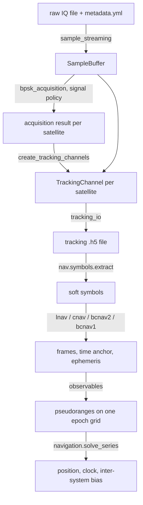

# Architecture of `gnss_processing/`

This document describes what exists now (2026-10-15, after the BeiDou B2a and
B1C port). It is descriptive. The port plan is `BDS_PORT_PLAN.md`; the
follow-up list is `BDS_FOLLOW_UP.md`.

## 1. What this package does

`gnss_processing/` is HERON's post-processing chain for raw GNSS recordings.
It is HERON's own working copy of gps-tracking-example (see `../README.md`).
It reads one recording (an "experiment" described by `metadata.yml`, D-022),
despreads it, decodes the navigation message, and computes a position fix.

Three notebooks are the application layer. All logic is in `utils/`.

| Notebook | Job | Reads | Writes |
| --- | --- | --- | --- |
| `00-raw-signal-diagnostics` | Check that a recording is usable | raw IQ | figures |
| `01-acquisition-and-tracking` | Find and track satellites of one signal | raw IQ | tracking `.h5` file |
| `02-navigation` | Decode the message, form pseudoranges, solve the position | tracking `.h5` file | figures, fix |

Signals that run end to end: GPS L1 C/A, L2C, L5, BeiDou B2a, BeiDou B1C.
GPS L1C acquires and tracks (codes in `utils/gps_l1c.py`, PRN 1 to 63), but notebook 02 stops at its
message (the LDPC decoder is missing in `nav/cnav2.py`).

## 2. Layout

```
gnss_processing/
├── notebooks/        # 00, 01, 02 (the drivers), plus two dev notebooks
├── scripts/          # run_notebook.py (headless runs), compare_bds_orbits.py
├── utils/            # all logic (this section 3)
│   └── nav/          # navigation-message decoders and coding primitives
├── tests/            # pytest suite; synthetic.py makes signals
├── docs/             # this file, the port plan, the ICDs, the baseline list
├── submodules/gnss-tools/   # git submodule: PRN codes (GPS), RINEX, SP3, coordinates
└── local-data/       # gitignored: outputs, notebook run logs
```

Run the tests from this folder with `uv run pytest`. The baseline has known
failures that are not BeiDou work (`docs/BDS_BASELINE_TESTS.md`).

## 3. Modules in `utils/`

### 3.1 Signals and codes

| Module | Role |
| --- | --- |
| `code_components.py` | Describes a signal as code components: sequence, branch (I or Q), overlay, subcarrier, power weight. No GPS constants. |
| `signal_interfaces.py` | One `Signal` class for each signal (`GpsL1CA`, `GpsL2C`, `GpsL5`, `GpsL1C`, `BdsB2a`, `BdsB1C`). `ACQUISITION_POLICIES` and `TRACKING_POLICIES` choose how each is acquired and tracked. Add a signal here. |
| `gps_l1c.py` | GPS L1C codes, overlay and constants (PRN 1 to 63), numbers in `docs/icd/l1c_code_tables.json`. |
| `bds_b2a.py`, `bds_b1c.py` | BeiDou code generators and constants. No dependency on `gnss-tools`, so upstream can take them (D-048). B1C reads its `(w, p)` pairs from `docs/icd/bds_b1c_code_tables.json`. |
| `secondary_code.py` | Overlay (secondary code) search and wipe-off. |
| `ambiguity_resolution.py` | Resolves what acquisition leaves open (L2C CL). |

### 3.2 Acquisition and tracking

| Module | Role |
| --- | --- |
| `sample_streaming.py`, `collect_metadata_utils.py`, `catalog.py` | Read raw files and `metadata.yml`; list what is on disk. |
| `bpsk_correlation.py` | Numba correlation kernels. The only per-sample loop. Handles BOC subcarriers. |
| `bpsk_acquisition.py` | FFT acquisition over a Doppler grid. |
| `tracking_channel.py` | One closed-loop channel (DLL, PLL, FLL, overlay sync, symbol grid) driven by a policy. |
| `tracking_supervisor.py`, `gap_consensus.py` | Recover a channel that lost lock; make channels agree on dropped time. |
| `tracking_io.py` | Save and load tracking runs (`.h5`). |

### 3.3 Navigation message (`utils/nav/`)

| Module | Message |
| --- | --- |
| `symbols.py` | Tracking outputs to soft symbols. Tables per signal: data component, symbol period, overlay, quadrature. |
| `lnav.py`, `cnav.py`, `cnav2.py` | GPS LNAV, CNAV, CNAV-2. |
| `bcnav2.py` | BeiDou B-CNAV2 (B2a): preamble search, LDPC, CRC, types 10, 11, 30. |
| `bcnav1.py` | BeiDou B-CNAV1 (B1C): frame search on the BCH-coded PRN field, interleaver, two LDPC codes, CRC, subframes 2 and 3. |
| `ldpc.py`, `ldpc_b1c_tables.py` | The three 64-ary LDPC codes in one class, with a soft min-sum decoder. |
| `primitives.py` | CRC-24Q, BCH, interleaver and convolutional code for the GPS formats. |
| `ephemeris.py` | `LnavEphemeris`, `CnavEphemeris`, `BdsEphemeris` (orbit and clock). |

### 3.4 Position

| Module | Role |
| --- | --- |
| `observables.py` | Time anchors from a decoded message; pseudoranges on one epoch grid; `combine_observables` for several runs. |
| `navigation.py` | Satellite positions, corrections, least squares with one clock and one inter-system bias per extra system, RAIM, weights. |
| `multi_signal.py` | Decodes a BeiDou tracking run (B2a or B1C) into anchors and ephemerides. |
| `time_systems.py` | GPST and BDT (BDT = GPST - 14 s). |
| `period_ambiguity.py` | Fixes a whole-code-period error in one satellite. |
| `broadcast_ephemeris.py`, `rinex3_nav.py`, `cddis.py`, `precise_orbits.py`, `bds_orbit_check.py` | Broadcast and precise orbits, for GPS and BeiDou. |

### 3.5 Support

`environment_variables.py` (the `.env` file), `tables.py`, `plotting.py`, `basemap.py`.

## 4. Data flow



Notebook 01 runs the top half for one signal. Notebook 02 runs the bottom
half. For a combined fix (section 10 of notebook 02) notebook 01 runs once for
each signal and notebook 02 joins the files (D-058).

## 5. How a signal is described

A signal is a `Signal` subclass. It builds a `CodeSet`: its code components.
Nothing else in the chain knows the signal by name; it reads three tables.

1. `ACQUISITION_POLICIES[signal_type_id]`: which component to acquire on,
   and whether to fold the overlay into the replica.
2. `TRACKING_POLICIES[signal_type_id]`: which component the carrier loop uses,
   which components the delay loop uses, when to stop the Costas loop, and how
   to search the overlay.
3. The tables in `nav/symbols.py` and `observables.py`: symbol period, data
   component, whether the data is in quadrature, the band frequency.

To add a signal, add a class, three policy rows, and the table rows. B1C
(`BdsB1C`) is the newest example.

## 6. Time

Each time anchor says its own time system. GPS anchors are in GPST. BeiDou
anchors are in BDT. The pseudorange formation moves everything to GPST for a
mixed set. The ephemeris is always evaluated in its own system time
(`observables.ephemeris_time_s`). Wrong time scales give errors of 14 s, so
the tests check this on purpose.

## 7. Known limits

- The tracker needs the symbol grid tied to the overlay counter. B2a
  acquires only modulo 1 ms, so without this the epochs sit up to 4 ms off the
  symbol edge (D-059). Tracking files made before that fix are not valid for B2a.
- No ionosphere correction is applied to BeiDou (D-053).
- B1C is tracked in narrow-band mode only (D-062).
- The BeiDou decoders are tested on synthetic signals and, for B2a, on one
  real recording (D-052). B1C has no real-data check yet (D-064, Q-019).
